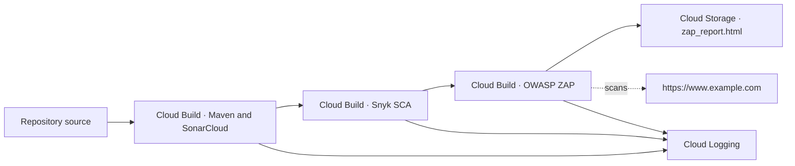

# DevSecOps Pipeline Using Google Cloud Build

This repository demonstrates security checks for an intentionally vulnerable Java application. Google Cloud Build runs Maven verification and SonarCloud analysis, invokes Snyk software composition analysis (SCA), and runs an OWASP ZAP dynamic application security test (DAST) against a configured URL. The checked-in pipeline ends with report publication to Cloud Storage. Application deployment is outside the scope of this configuration.

Reviewed revision: [`f6dae7c`](https://github.com/AmeerHossam/DevSecOps-Pipeline-using-GCP-services/commit/f6dae7c94b84f09121883c848eaa0d3f6de9644e).

## Architecture and stages



[`cloudbuild.yaml`](cloudbuild.yaml) defines three sequential steps. Each starts after the preceding step completes successfully according to Cloud Build. Maven's failure handling in step 2 affects what Cloud Build sees.

| Stage | Implementation | Result and failure behavior |
| --- | --- | --- |
| Maven verification and SonarCloud | Runs in `maven:3-openjdk-18-slim`, installs Git, then runs `mvn verify org.sonarsource.scanner.maven:sonar` with `-e -X`. The [Maven POM](pom.xml) targets Java 8, uses JUnit 4 and configures JaCoCo XML coverage. | Runs the Java tests and sends analysis to SonarCloud. A nonzero Maven exit fails the step. The command does not explicitly wait for or enforce a SonarCloud quality gate. |
| Snyk SCA | Runs in `ubuntu`, installs Maven, exports `SNYK_TOKEN`, and runs `mvn snyk:test -fn`. The POM pins Snyk's Maven plugin to `2.0.0` and sets its organization to `asecurityguru`. | Scans Maven dependencies. Maven's `-fn` flag can let the build continue despite a scan failure or findings. Inspect the step log for the actual outcome. |
| OWASP ZAP DAST | Runs in `ubuntu`, installs `wget` and the default JDK, downloads ZAP `2.16.0` from GitHub, and runs `zap.sh -cmd -quickurl https://www.example.com -quickprogress -quickout ../zap_report.html` from the extracted directory. | Writes `zap_report.html` at the workspace root. Cloud Build is configured to upload it to `gs://sec-bucket-dast/zap_report.html` after the steps succeed. The pipeline has no separate check for report findings. |

Cloud Build executes the stages. Cloud Logging receives the build logs through `CLOUD_LOGGING_ONLY`. Cloud Storage holds the ZAP HTML artifact. SonarCloud and Snyk are external scanning services. The Gradle files are separate from the Maven-based Cloud Build workflow.

## Triggers and deployment

The repository supplies a Cloud Build configuration and leaves trigger setup to the Google Cloud project. It does not establish which branch, event, schedule, region, or service account a live trigger uses. For an automated setup, connect the GitHub repository in Cloud Build, select the event and branch filter you intend to use, and point the trigger at `cloudbuild.yaml`. [Cloud Build trigger setup](https://docs.cloud.google.com/build/docs/automating-builds/create-manage-triggers)

The ZAP step targets an existing external URL. The build does not start the Java application, publish an application image, or deploy to Cloud Run, GKE, or another runtime. A ZAP report from the checked-in configuration describes the configured external target and cannot establish coverage of the Java demo.

## Configuration and credentials

| Setting | Checked-in behavior | Setup for your project |
| --- | --- | --- |
| SonarCloud | `https://sonarcloud.io`, organization `ameerhossam`, project key `DevSecOps-Pipeline-using-GCP-services`. The scanner receives `_SONAR_TOKEN` through `sonar.token`. Its YAML default is empty. | Set your organization and project key in the scanner command and provide a token authorized to analyze that project. |
| Snyk | The shell exports `SNYK_TOKEN` from `_SNYK_TOKEN`. The YAML references the substitution without declaring a default. | Supply `_SNYK_TOKEN` for every run and change the POM organization if needed. A triggered build can accept a missing substitution during validation, so inspect Snyk authentication in the build log. |
| ZAP target | The URL is hard-coded as `https://www.example.com`. | Set `-quickurl` to a reachable endpoint you are authorized to scan. |
| Report destination | `artifacts.objects.location` is set to `gs://sec-bucket-dast`. | Use an existing bucket you control and give the build identity permission to write the report. Give report readers permission to read it. |

The tracked `env` file contains legacy Sonar settings, including a `sonar.login` entry. The pipeline does not source this file. Treat any still-valid credential from it as exposed and revoke or rotate it. The current pipeline passes tokens as build substitutions and has no Secret Manager integration. Avoid committing tokens or saving commands with literal token values. For shared or production use, wire in Secret Manager before supplying production credentials. [Cloud Build substitution behavior](https://docs.cloud.google.com/build/docs/configuring-builds/substitute-variable-values)

## Prerequisites

- A Google Cloud project with Cloud Build enabled and a build identity that can write to Cloud Logging and upload objects to the configured Cloud Storage bucket.
- A caller with permission to submit builds or administer the intended trigger. Install and authenticate the Google Cloud CLI for manual submission.
- SonarCloud and Snyk access to the configured project and organization, with valid scan credentials.
- Build workers with access to the container images, OS package repositories, Maven dependencies, SonarCloud, Snyk, the ZAP release on GitHub, and the authorized DAST target.
- A JDK and Maven if running the Java verification locally.

## Usage

Clone the repository and enter its root.

```bash
git clone https://github.com/AmeerHossam/DevSecOps-Pipeline-using-GCP-services.git
cd DevSecOps-Pipeline-using-GCP-services
```

Run the Maven verification lifecycle locally to compile the demo and run its unit tests.

```bash
mvn verify
```

For a manual Cloud Build run, first update the scanner settings, ZAP target, and artifact bucket for your environment. With `GCP_PROJECT_ID`, `SONAR_TOKEN`, and `SNYK_TOKEN` already set in your shell, submit from the repository root. This example uses the current substitution interface. Token values are passed to Cloud Build as build configuration.

```bash
gcloud builds submit . \
  --project="${GCP_PROJECT_ID}" \
  --config=cloudbuild.yaml \
  --substitutions="_SONAR_TOKEN=${SONAR_TOKEN},_SNYK_TOKEN=${SNYK_TOKEN}"
```

Open the build in Cloud Build History and inspect each stage in order. Check SonarCloud for analysis results, the Snyk step log for SCA findings, and the configured bucket for `zap_report.html`. [Manual submission reference](https://docs.cloud.google.com/sdk/gcloud/reference/builds/submit)

## Troubleshooting

| Symptom | What to check |
| --- | --- |
| Submission reports an unresolved substitution | Pass both token substitutions. `_SNYK_TOKEN` has no checked-in default and `_SONAR_TOKEN` defaults to empty. |
| SonarCloud rejects authentication or project access | Verify the token, organization, and project key together. For missing coverage, check Maven's test and JaCoCo output before investigating scanner import. For missing Git metadata, check the checkout method and whether the build received Git history. |
| The build is green but Snyk reports findings or an error | Read the Snyk log. `-fn` can mask Maven failures in the overall result. Check the token and POM organization when authentication fails. |
| A stage fails before scanning | Check image pulls, package installs, Maven dependency resolution, and worker network access. The ZAP step also needs the pinned GitHub release and a reachable target. |
| ZAP report is missing or stale | Confirm ZAP wrote `zap_report.html` at the workspace root, then inspect the artifact upload result, destination bucket, and build identity permissions. The configured report name is fixed across builds. |
| Build logs are unavailable | Verify that the build identity can write to Cloud Logging and your account can view the build logs. |

## Demo application

The project intentionally includes `nd4j-common:1.0.0-beta2` and `commons-collections:3.2.1` for a Snyk reachability demonstration. The `Unzipper` example uses `malicious_file.zip` to demonstrate Zip Slip and can write `/tmp/evil.txt`. The Commons Collections example illustrates potentially reachable vulnerable code. Use the exploit fixture only in an isolated test environment. The CI Snyk command uses `snyk:test` without the separate CLI reachability flags described in the original demo instructions.
